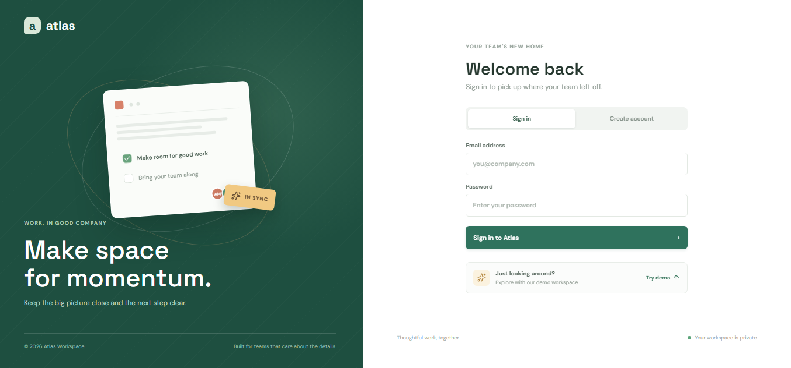
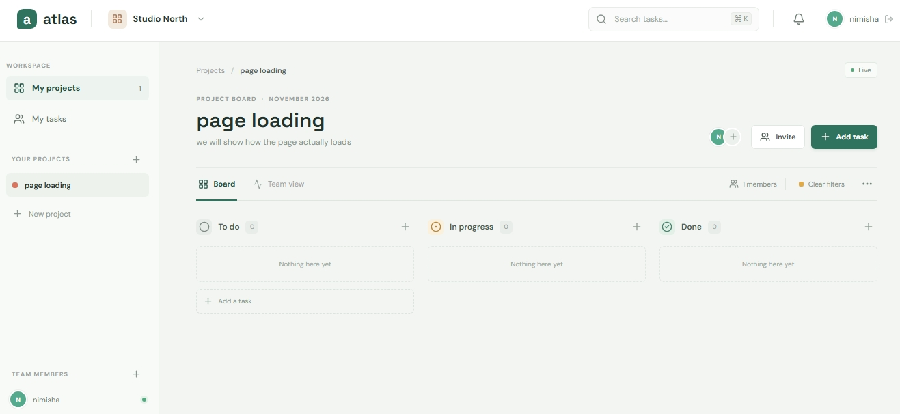
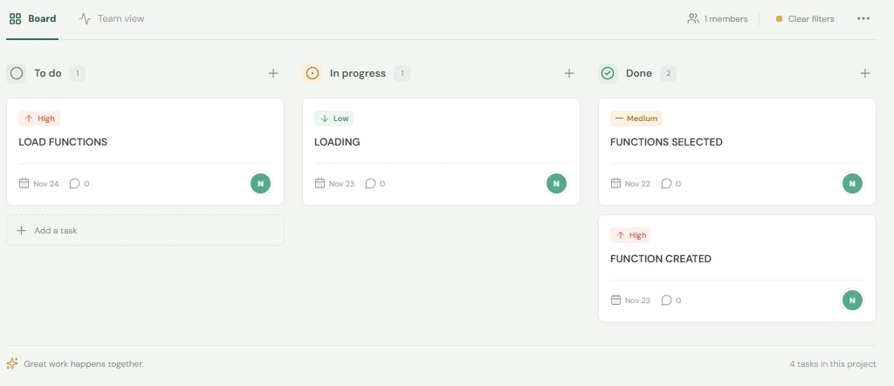
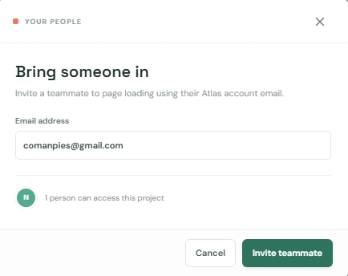

# Atlas Project Workspace

A full-stack project management application that helps teams organize projects, assign tasks, collaborate through comments, and receive real-time notifications.

Built using **React, TypeScript, Node.js, Express, Socket.IO, and MongoDB**.

---

## Features

- **User Authentication:** Secure registration and login with hashed passwords and JWT authentication.
- **Project Management:** Create projects, manage project details, and invite existing users.
- **Task Management:** Create, assign, edit, delete, and organize tasks.
- **Task Priorities:** Set task priorities to Low, Medium, or High.
- **Task Status Tracking:** Move tasks across To Do, In Progress, and Done.
- **Comments:** Collaborate through task-specific comment threads.
- **Notifications:** Receive notifications for task assignments and comments.
- **Real-Time Collaboration:** Socket.IO-powered updates for project members.
- **Database Persistence:** Store workspace data in MongoDB.

---

## Tech Stack

| Category | Technology |
|---|---|
| Frontend | React, TypeScript, CSS |
| Backend | Node.js, Express.js |
| Database | MongoDB Atlas, Mongoose |
| Authentication | JWT, bcryptjs |
| Real-Time Communication | Socket.IO |
| Build Tool | Vite |

---

## Screenshots

### 1. Login 


### 2. Dashboard


### 3. Task Management


### 4. Invite Teammate


---

## Installation and Setup

### Prerequisites

- Node.js and npm
- MongoDB Atlas account or a local MongoDB instance
- Git

### 1. Clone the repository

```bash
git clone YOUR_GITHUB_REPOSITORY_URL
```

### 2. Navigate to the project directory

```bash
cd CodeAlpha_ProjectManagementTool
```

### 3. Install dependencies

```bash
npm install
```

### 4. Configure environment variables

Create a `.env` file in the root directory using `.env.example` as a template.

Configure the following variables:

```env
PORT=3001
MONGO_URI=your_mongodb_connection_string
JWT_SECRET=your_long_random_secret
CLIENT_ORIGIN=http://localhost:5173
```

**Important:** Never upload your actual `.env` file or database credentials to GitHub.

### 5. Start the application

```bash
npm run dev
```

The command starts both the frontend and backend.

Open the Vite development URL displayed in your terminal, usually:

```text
http://localhost:5173
```

The Express API runs on port `3001`.

---

## Demo Account

You can use the demo account to explore the application:

| Field | Credentials |
|---|---|
| Email | demo@atlas.app |
| Password | demo1234 |

Alternatively, register a new account.

To test collaboration, register a second account and invite that user to a project.

---

## Production Build

To create a production build:

```bash
npm run build
```

To start the application:

```bash
npm start
```

The Express server serves the frontend build and backend API.

Set a strong, unique `JWT_SECRET` before deploying publicly.

---

## Project Structure

```text
CodeAlpha_ProjectManagementTool/
│
├── public/
│
├── server/
│   ├── config/
│   │   └── db.ts
│   └── index.ts
│
├── src/
│   ├── assets/
│   ├── App.tsx
│   ├── App.css
│   ├── index.css
│   └── main.tsx
│
├── .env.example
├── .gitignore
├── index.html
├── package.json
├── package-lock.json
└── README.md
```

---

## Internship Project

**Program:** CodeAlpha Full Stack Development Internship

**Project:** Project Management Tool

**Repository:** CodeAlpha_ProjectManagementTool
